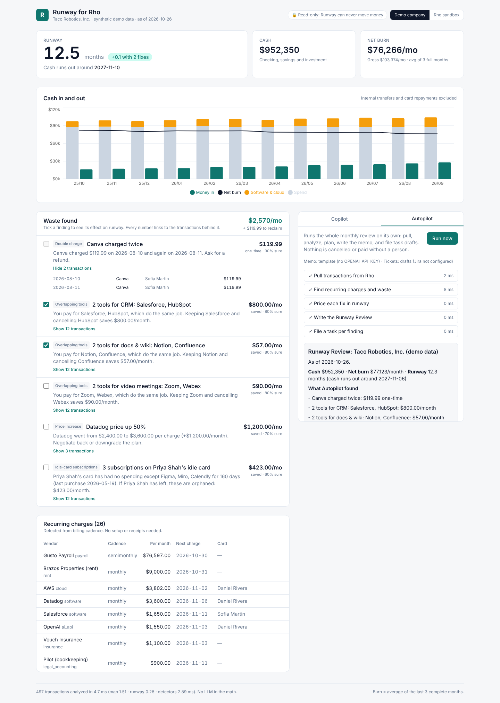

# Runway for Rho

**Finds the wasted spend in a startup's Rho account and turns it into months of runway.**

Built at the AITX & MLOps World Community Hackathon (Austin Tech Week, Oct 26–29, 2026). Tracks: 💳 Rho Fintech and 🤖 Antler Agents.



## What it does

- **Burn and runway you can trust.** Cash, gross and net burn, runway and zero-cash date come from deterministic, tested TypeScript. The LLM never does the math.
- **Waste detection from bank data alone.** No integrations or receipts needed:
  - **Overlapping tools:** e.g. Zoom + Webex, or Salesforce + HubSpot doing the same job.
  - **Price increases:** e.g. Datadog quietly up 50%.
  - **Subscriptions still billing an idle card:** e.g. a departed teammate's card paying for Figma, Miro and Calendly.
  - **Double charges.**
- **Live what-if.** Tick findings and watch runway and the zero-cash date move.
- **Copilot** (chat agent): "Get me to 14 months without touching payroll." It plans with tools over the same math and drafts cancellation emails, downgrade requests and Jira tickets. Drafts are never sent automatically.
- **Autopilot** (autonomous agent): one click, or a schedule, runs the monthly review end to end: pull from Rho → analyze → price each fix in runway → write the Runway Review memo → file a task per finding. Every step is logged with timings.
- **Read-only by design.** Rho's API can't move money, and neither can Runway. Agents can only create drafts; the database refuses anything else.

## Quick start

```bash
npm install
cp .env.example .env.local   # optional: add OPENAI_API_KEY for Copilot and LLM memos
npm run dev                  # http://localhost:3000
```

The dashboard, what-if, detectors and Autopilot all work with **no keys at all** on the seeded demo company. Switch to **Rho sandbox** in the header to pull the live sandbox feed (`https://rhoapi-sandbox.rho.co/api/v1`, which accepts any token).

| Command | What it does |
|---|---|
| `npm test` | Unit tests (vitest) |
| `npm run eval` | Scores the detectors against planted waste across 5 seeds × 2 noise levels (`-- --write` updates `docs/eval-results.md`) |
| `npm run test:db` | Applies the Supabase migration to a throwaway local Postgres and checks tenant isolation, draft-only actions and the audit trail |
| `npm run typecheck` / `npm run lint` / `npm run build` | Static checks and production build |

## Reproducing the demo

1. `npm install && npm run dev`, then open http://localhost:3000. The demo company loads by default.
2. Tick findings in **Waste found** to see the runway change, and click **Show N transactions** for the evidence.
3. Open **Autopilot** → **Run now** to get the step log, the Runway Review memo and the task list.
4. With `OPENAI_API_KEY` set, open **Copilot** and click "Get me to 14 months of runway without touching payroll".

Environment variables (see `.env.example`):

| Variable | Needed for | Default |
|---|---|---|
| `OPENAI_API_KEY` | Copilot chat, LLM-written memo | unset: Copilot disabled, template memo |
| `OPENAI_MODEL_AGENT` / `OPENAI_MODEL_FAST` | Model choice | `gpt-6.1-sol` / `gpt-6-luna` |
| `RHO_BASE_URL` / `RHO_API_TOKEN` | Rho feed | sandbox URL / `sandbox` |
| `JIRA_BASE_URL`, `JIRA_EMAIL`, `JIRA_API_TOKEN`, `JIRA_PROJECT_KEY` | Filing real Jira tickets from Autopilot | unset: tickets stay as drafts |
| `SUPABASE_URL`, `SUPABASE_SERVICE_ROLE_KEY` | Persistence (schema in `supabase/migrations`) | not yet wired; see limitations |

## Stack and architecture

Next.js 16 (App Router) · TypeScript · Tailwind 4 · Recharts · Vercel AI SDK 7 with OpenAI GPT-6 · Supabase Postgres · zod · vitest

```
Rho API (read-only) ──► rho/client.ts ──► rho/map.ts ──► pipeline.ts ──────────────► Dashboard (what-if runs in the browser)
  or seeded demo          paginate, retry,   key (account,id),  ├ vendors/normalize   rules-first vendor matching
  company (Rho format)    validate (zod)     drop failed rows,  ├ finance/runway      burn, runway, goal-seek
                                             transfers ≠ burn   └ detect/*            recurring streams + 4 detectors
                                                                       │
                                     ┌─────────────────────────────────┴───────────────────────────┐
                                     ▼                                                             ▼
                      Copilot (AI SDK ToolLoopAgent)                         Autopilot (fixed pipeline)
                      tools = agent/tools.ts (zod-validated,                 sync → analyze → plan → memo → file_tasks
                      pure functions; no raw SQL)                            LLM memo rejected unless every $ / month
                                                                             figure matches the analysis; Jira via ADF
```

Design choices worth knowing:

- **Rules before models.** A vendor catalog with alias matching resolves about 97% of vendors on the demo data with zero LLM calls (see eval).
- **Plan-then-execute Autopilot.** The step sequence is fixed before any (untrusted) bank text is read, so a hostile transaction description can't change what actions run.
- **Tenant-ready schema** (`supabase/migrations`):
  - `org_id` and RLS on every table; members can only read.
  - Fingerprinted findings and actions, so a re-run never revives a dismissed item or files a duplicate ticket.
  - A trigger rejects any agent-created action that isn't a draft.
  - Status changes go through RPCs that write an append-only audit log.
  - Agent runs and steps are logged in OpenTelemetry GenAI shape with integer costs.

## Evaluation

`npm run eval` (latest run, also in [docs/eval-results.md](docs/eval-results.md)):

| Detector | Precision | Recall |
|---|---|---|
| Overlapping tools | 100% | 100% |
| Price increase | 100% | 100% |
| Idle-card subscriptions | 100% | 100% |
| Double charge | 100% | 100% |

- **Dollar-weighted recall:** 100%.
- **Rules-only vendor categorization:** 96.9%. The one miss is an unknown coffee shop left for the LLM.
- **Speed:** full analysis of ~500 transactions in about 4–6 ms.

Each company also contains negative controls that must not be flagged: usage-based AWS/OpenAI growth, Slack + Zoom + Loom, AWS + Vercel, and varying airfare.

**Honest caveat:** the detectors were developed against this generator. These numbers show the logic works on known patterns, not accuracy on real ledgers. The eval did catch two real false positives during development, which were fixed with regression tests: two people's identical orders flagged as a double charge, and airfare flagged as price creep.

## Data and provenance

- **Taco Robotics, Inc.** is a **synthetic** company generated by `src/lib/seed/demo-company.ts` (deterministic, seeded). Every row is fake, in Rho's exact wire format, with planted waste recorded as ground truth. The UI labels it as demo data.
- **Rho sandbox** is Rho's own fictional, static feed. It has 72 transactions ending June 2026 and almost no SaaS spend, so Runway dates its analysis by the latest transaction when using it.
- **Prior art** (studied, not copied): see [docs/prior-art.md](docs/prior-art.md) for what earlier Rho hackathon projects taught us about the API.

## Known limitations and next steps

- **No user authentication yet.** The app serves one demo tenant. Before connecting a real Rho account, it needs Supabase Auth, per-org data loading and rate limiting on the agent routes.
- **Supabase persistence is designed and tested** (migration plus `npm run test:db`) but not yet wired into the app. Analysis currently runs in memory per request.
- **The LLM vendor-categorization fallback isn't implemented yet.** Unknown vendors are labelled "other".
- **Zombie detection is a heuristic.** Bank data has no usage data, so "idle card" stands in for "unused". SSO or Google Workspace signals would make it precise.
- **Not built yet:**
  - Apify-scraped plan pricing for "cheaper tier" suggestions.
  - Renewal calendar.
  - AI-token spend tracker.
  - Treasury idle-cash insight.
  - Monte Carlo runway bands.
- **The Rho field mapping is unverified.** It was built from Rho's public docs and earlier hackathon clients, and needs re-checking against the live sandbox and production API.

## Team

| Name | Role | Contact |
|---|---|---|
| Ayan Bhardwaj | Builder | _add contact_ |
