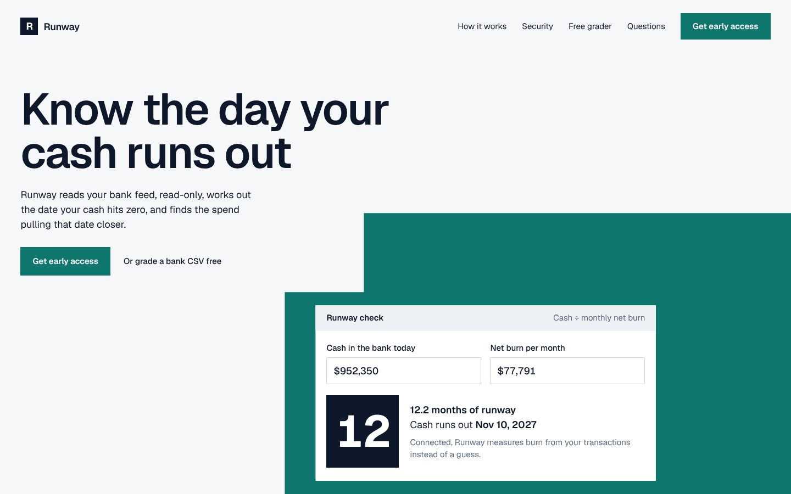
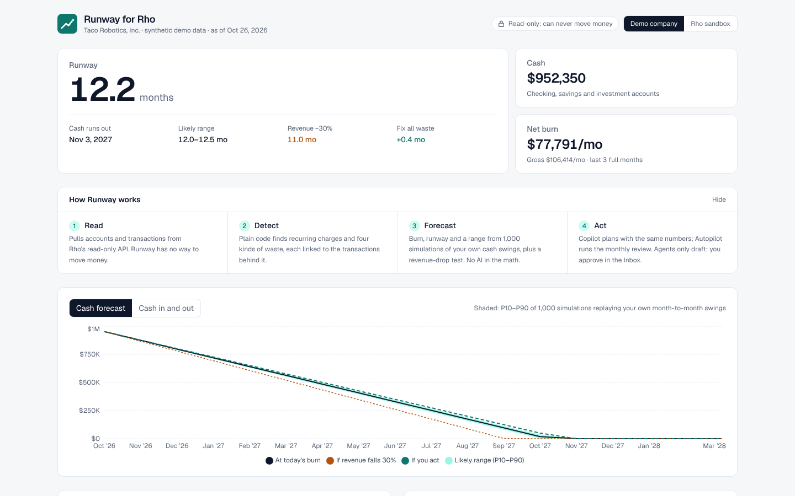

# Runway

**Know the day your startup's cash runs out, and find the spend pulling it closer.**

Runway reads a company's bank feed (read-only), works out burn, runway and the zero-cash date with plain arithmetic, finds wasted spend, and sends what changed to Slack every Monday. Agents draft the fixes; a person approves every one.

[](https://github.com/AyanBhardwaj1/AITX-MLOps-Hack/actions/workflows/ci.yml) [](https://vercel.com/new/clone?repository-url=https%3A%2F%2Fgithub.com%2FAyanBhardwaj1%2FAITX-MLOps-Hack&project-name=runway-for-rho)

**Status: early access.** Runway started as a hackathon project at the AITX & MLOps World Community Hackathon (Austin Tech Week, Oct 26–29, 2026; Rho Fintech and Antler Agents tracks) and is now an independent product. It is not affiliated with Rho or any bank. The hackathon write-up is kept in [SUBMISSION.md](SUBMISSION.md).

| Where | What |
|---|---|
| `/` | Public site: live runway calculator, what Runway finds, security, FAQ and the early-access form |
| `/app` | The product, on a synthetic demo company by default; signed-in founders see their own company (`/app?mode=company`) |
| `/login`, `/app/upload`, `/app/settings` | Email-link sign-in (it returns you to the page that asked), uploading bank exports into your company (or a sample export to try it), and renaming or deleting the company |
| `/grader` | Free CSV runway grader; runs entirely in the browser |
| `/privacy`, `/security`, `/terms` | Early-access policies (drafts pending legal review) |





## What it does

- **Burn and runway you can trust.** Cash, gross and net burn, runway and zero-cash date come from deterministic, tested TypeScript. The LLM never does the math.
- **Waste detection from bank data alone.** No integrations or receipts needed:
  - **Overlapping tools:** e.g. Zoom + Webex, or Salesforce + HubSpot doing the same job.
  - **Price increases:** e.g. Datadog quietly up 50%.
  - **Subscriptions still billing an idle card:** e.g. a departed teammate's card paying for Figma, Miro and Calendly.
  - **Double charges.**
- **Live what-if.** Tick findings and watch runway and the zero-cash date move.
- **Cash forecast with a range, not a guess.**
  - A 1,000-path Monte Carlo follows the last six months' burn trend (when it is statistically real) and the noise around it, giving a P10–P90 runway range and zero-cash dates. How it was chosen and how well it holds: [forecast-trend.md](sleep-research/runs/forecast-trend.md).
  - It sits alongside an "if you act" line that follows your what-if selection.
  - A stress line shows what happens if revenue falls 30%.
- **Renewals calendar.** Every subscription charge due in the next 60 days, with annual, quarterly or $5k+ renewals flagged as decisions to make *before* they renew.
- **AI & LLM spend tracker.** Monthly API spend, compound growth rate, share of spend and a 12-month projection: the fastest-growing line item at AI startups.
- **Copilot** (chat agent): "Get me to 14 months without touching payroll." It plans with tools over the same math and drafts cancellation emails, downgrade requests and Jira tickets. Drafts are never sent automatically. With no OpenAI key, its suggested questions are still answered instantly by the same tools through a fixed template, labelled as not AI-written.
- **Autopilot** (autonomous agent): one click, or a schedule, runs the monthly review end to end: pull from Rho → analyze → price each fix in runway → write the Runway Review memo → file a task per finding. Every step is logged with timings.
- **Inbox: a person approves every action.** Copilot and Autopilot drafts (vendor cancellation emails, downgrade requests, card-limit checklists, tickets) wait in an Inbox. Approving a ticket files it in Jira, and approved emails are ready to copy and send.
- **Decisions that stick.**
  - Mark a finding "Act on this" or **Dismiss** it.
  - Dismissals survive later detector runs, and Autopilot skips dismissed findings.
  - Every decision lands in an append-only audit log.
- **Runs on its own.**
  - Autopilot also runs daily via Vercel Cron.
  - Each run's steps and memo are kept as history.
- **This week + Monday digest.** Deterministic alerts for spend spikes, large one-off payments, subscription price changes, new vendors, renewals due within 14 days and low runway. The same list, plus runway, the default-alive verdict and open waste, goes to Slack every Monday (incoming webhook).
- **Plan ahead: default alive?** Paul Graham's test, computed: revenue growth is estimated from six months of the feed, and the planner projects month by month with hires, a raise, cut waste or a different growth rate. It shows break-even, the cash-out date and the minimum growth that keeps you alive.
- **Verified savings.** After you act on a finding, Runway watches the next bills: a cancelled tool must stop charging, a price increase must drop back, a double charge needs its refund. Only verified money counts as saved, and anything still charging is flagged.
- **Free CSV Runway Grader** (`/grader`, no signup). Drop bank and card exports: the importer finds the date, description and amount (or separate debit and credit) columns under the names banks commonly use (Posting Date, Transaction Date, Payee, Withdrawals…), skips a summary block above the header, reads files with no header row, turns cards that list charges as positive (a Card Member column) the right way round, and lets you flip any other file that does. These layouts are modelled on common exports, not yet tested on every bank's real files (`tests/bank-formats.test.ts`) and type today's cash. You get runway, a range with the burn trend and the top wasted spend. It runs in your browser: a Playwright check logged zero network requests during grading. It also states plainly what a given upload can't see, such as card waste in a checking-only export. After a result you can print it or save it as a PDF (built in the browser), and join early access; only the email is sent.
- **Runway over time.** Runway at the start of each of the last six months, rebuilt from the feed (that day's cash over the burn measured then), so you can see whether it is growing or shrinking.
- **Vendor history.** Click any recurring charge for its last 12 months: monthly totals, price changes and the latest bills with who paid.
- **Your own company.** Founders sign in with an email link (invite-only during early access; sign-in returns them to the page they asked for), get a private company, and upload CSV exports from their bank and cards plus today's cash, or a sample export to try it first. Files are parsed in the browser with the grader's importer and previewed before sending; only rows are sent, re-validated on the server and stored once even when exports overlap (a re-upload with corrected signs fixes rows rather than adding to them). Every feature then runs on their own data: the dashboard, Copilot, Autopilot (also run daily for every company), the investor update and share links. The upload page shows what's stored per account, deletes one account's rows or everything, and downloads it all as a CSV that re-uploads cleanly; the dashboard nudges when the data is two weeks old and shows a getting-started checklist.
- **Teams.** The owner invites teammates by email from `/app/settings`, renames or deletes the company there, and every accepted or dismissed finding shows who decided it and when. Needs Supabase Auth and `DATABASE_URL` (see DEPLOY.md).
- **Share with investors.** A read-only link (`/s/<token>`) to today's cash, burn, runway, its range and its trend, with no vendors, people or transactions. Links expire after 7, 30 or 90 days and can be revoked; only a SHA-256 hash of the token is stored, and the page sends `no-referrer`, `no-store` and `noindex`. The public demo stores nothing and points to a live sample at `/s/demo`. Needs `DATABASE_URL` and `APP_PASSWORD`.
- **Runway goal.** Type the runway you want (18 months by default). Runway lists the findings that get there, largest first, and if they don't, how much more to cut each month or how much to raise instead.
- **Where the money goes.** Average monthly spend per category for the last 3 complete months against the 3 before, as a dumbbell per category, with a table view.
- **CSV export.** Recurring charges and findings download as CSV for spreadsheets and board prep; text from bank descriptors is defused so a spreadsheet can't run it as a formula.
- **Category fixes that stick.** "Fix" on any recurring charge sets the vendor's category (and, for software, the job it does). Fixes are saved per company, override the catalog and AI labels, and every number follows: mark a misread transfer as a transfer and it leaves burn; tell Runway that Loom is your video-meeting tool and it flags the overlap with Zoom. Each fix can be undone.
- **Inbox ordered by what's at stake.** Drafts waiting for approval are sorted by the dollar impact of their finding, so the few approvals you make each week are the ones that matter.
- **Investor update.** This month's update drafted from the bank feed: revenue and month-over-month change, burn, cash, runway, default alive, software spend moves and verified cuts. Wins, misses and asks stay marked for you to write.
- **Read-only by design.** Rho's API can't move money, and neither can Runway. Agents can only create drafts; the database refuses anything else.
- **Public site and early access.** The landing page's numbers are computed by the same engine from the demo company at build time. Signups go to `POST /api/waitlist` (validated, rate-limited, honeypot, same answer for new and repeat emails) and a `waitlist` table that no public or signed-in database role can read.

## Quick start

```bash
npm install
cp .env.example .env.local   # optional: add OPENAI_API_KEY for Copilot and LLM memos
npm run dev                  # http://localhost:3000 (site), /app (product)
```

The dashboard, what-if, detectors and Autopilot all work with **no keys at all** on the seeded demo company. Switch to **Rho sandbox** in the header to pull the live sandbox feed (`https://rhoapi-sandbox.rho.co/api/v1`, which accepts any token).

| Command | What it does |
|---|---|
| `npm test` | Unit tests (vitest) |
| `npm run eval` | Scores the detectors against planted waste across 5 seeds × 2 noise levels (`-- --write` updates `docs/eval-results.md`) |
| `npm run test:db` | Applies the Supabase migrations to a throwaway local Postgres and checks tenant isolation, draft-only actions and the audit trail |
| `npm run test:integration` | Runs the same persistence contract the unit tests use, against real Postgres (throwaway database) |
| `npm run db:migrate` | Applies `supabase/migrations` to `DATABASE_URL`, once each (safe to re-run) |
| `npm run verify:live` | Checks every configured integration (Rho, OpenAI, database, Jira) against the real services: PASS / FAIL / SKIP |
| `npm run typecheck` / `npm run lint` / `npm run build` | Static checks and production build |

## Reproducing the demo

1. `npm install && npm run dev`, then open http://localhost:3000/app. The demo company loads by default.
2. Tick findings in **Waste found** to see the runway change, and click **Show N transactions** for the evidence.
3. Open **Autopilot** → **Run now** to get the step log, the Runway Review memo and the task list.
4. Open **Copilot** and click "Get me to 14 months of runway without touching payroll". Without `OPENAI_API_KEY` you get the instant (template) answer; with it, the agent plans live and you can ask anything.

Every credential is optional, and each one switches on one more piece: GPT features, permanent storage, a password, your real Rho account, the daily schedule, Jira. **[DEPLOY.md](DEPLOY.md)** lists where each value comes from and the exact setup steps. `.env.example` has the full list.

## Stack and architecture

Next.js 16 (App Router) · TypeScript · Tailwind 4 · Recharts · Vercel AI SDK 7 with OpenAI GPT-6 · Supabase Postgres · zod · vitest

```
Rho API (read-only) ──► rho/client.ts ──► rho/map.ts ──► pipeline.ts ──────────────► Dashboard (what-if runs in the browser)
  or seeded demo          paginate, retry,   key (account,id),  ├ vendors/normalize   rules-first vendor matching
  company (Rho format)    validate (zod)     drop failed rows,  ├ finance/runway      burn, runway, goal-seek
                                             transfers ≠ burn   └ detect/*            recurring streams + 4 detectors
                                                                       │
                                     ┌─────────────────────────────────┴───────────────────────────┐
                                     ▼                                                             ▼
                      Copilot (AI SDK ToolLoopAgent)                         Autopilot (fixed pipeline)
                      tools = agent/tools.ts (zod-validated,                 sync → analyze → plan → memo → file_tasks
                      pure functions; no raw SQL)                            LLM memo rejected unless every $ / month
                                                                             figure matches the analysis; Jira via ADF
```

Design choices worth knowing:

- **Rules before models.**
  - A vendor catalog with alias matching resolves about 97% of vendors on the demo data with zero LLM calls (see eval).
  - Only the unknown remainder goes to the cheap model (`gpt-6-luna`), once per vendor and cached.
  - The model's output is forced into the same closed category and job lists, and gated on confidence.
  - If the model fails, the app falls back to rules only.
- **Plan-then-execute Autopilot.** The step sequence is fixed before any (untrusted) bank text is read, so a hostile transaction description can't change what actions run.
- **Tenant-ready schema** (`supabase/migrations`):
  - `org_id` and RLS on every table; members can only read.
  - Fingerprinted findings and actions, so a re-run never revives a dismissed item or files a duplicate ticket.
  - A trigger rejects any agent-created action that isn't a draft.
  - Status changes go through RPCs that write an append-only audit log.
  - Agent runs and steps are logged in OpenTelemetry GenAI shape with integer costs.

## Production readiness

- **CI on every push** ([`.github/workflows/ci.yml`](.github/workflows/ci.yml)):
  - typecheck, lint, the unit tests (396 at last count) and a production build;
  - the detector eval, which fails the build below 95% precision or recall;
  - `npm audit`;
  - schema tests and the Postgres store contract against a real Postgres service.
- **Security headers:** strict Content-Security-Policy (no third-party scripts or connections), HSTS, `X-Frame-Options: DENY`, `nosniff`, a tight referrer and permissions policy, and no `X-Powered-By`.
- **Public pages stay public:** with `APP_PASSWORD` set, only `/app` and its data APIs ask for it; the site, legal pages, grader, signup, health check and cron routes don't (`isPublicPath` in `src/lib/access.ts`). `robots.txt` keeps `/app` and the API out of search.
- **Health check:** `GET /api/health` reports whether the database is reachable (and the deployed commit). It never returns configuration values and sits outside the password gate so uptime monitors can reach it.
- **Accessibility:** zero axe-core violations (WCAG 2.1 AA rules plus best practices) across all three agent tabs. The agent tabs are a keyboard-navigable ARIA tablist.
- **Failure handling:** if the Rho feed or the database is down, the dashboard falls back to the demo company or in-memory decisions and says so. Friendly error, not-found and loading pages, plus link-preview cards for sharing.

## Evaluation

`npm run eval` (latest run, also in [docs/eval-results.md](docs/eval-results.md)):

| Detector | Precision | Recall |
|---|---|---|
| Overlapping tools | 100% | 100% |
| Price increase | 100% | 100% |
| Idle-card subscriptions | 100% | 100% |
| Double charge | 100% | 100% |

- **Dollar-weighted recall:** 100%.
- **Rules-only vendor categorization:** 97.1%. The one miss is an unknown coffee shop, which the LLM fallback handles.
- **Speed:** full analysis of ~950 transactions in about 7–10 ms. The forecast's 1,000 simulations add about 10 ms.

Each company also contains negative controls that must not be flagged: usage-based AWS/OpenAI growth, Slack + Zoom + Loom, AWS + Vercel, varying airfare, and irregular one-offs (laptops, legal bills).

**Honest caveat:** the detectors were developed against this generator. These numbers show the logic works on known patterns, not accuracy on real ledgers.

### Stress test on ledger shapes the detectors weren't tuned for

`npm run stress-eval` re-scores the detectors on the same 20 seeds × 2 noise levels after transforming the ledger in ways real feeds differ from the generator:
- business-day posting
- vendor renames
- refunds
- a shared founder card
- per-person seat cards
- annual and usage-priced billing
- second workspaces billed the same day
- refunded double charges
- 12-month histories

The first run exposed three real defects: steady usage growth read as a price increase (43% precision), recurring second workspaces read as double charges (4%), and refunded double charges kept being flagged. To avoid grading our own homework, a separate agent wrote a **held-out** set of 15 variants without seeing the detector code (`src/lib/eval/heldout.ts`). It was frozen and run on the unfixed code, where precision on the affected detectors was 0–50%. The fixes were developed on the dev settings only. In the first committed after-fixes run of the held-out set, every detector scored 100% precision and recall wherever something was planted or found. In the three full-refund variants nothing was planted and nothing was found, which is correct.

Review round 1 then found two regressions in those fixes: separate one-off double charges months apart were hidden, and a staircase of raises was missed. Both are fixed, with regression tests, and the held-out set still passes on re-check. It is no longer a blind test at that point, since it had been seen.

Remaining stated limits:
- **Bank data can't tell a price rise from added seats.** A jump from 12 to 16 Slack seats shows as "Slack bill up 33%", so findings say "bill up" and "if you didn't add seats…".
- **A double charge that repeats in three or more consecutive months,** or that recurs about every 3 or 12 months, looks exactly like a second workspace billed quarterly or yearly, and isn't flagged.
- **A bill that is flat for a year and then starts growing** (or adds a seat every couple of months) can be read as a two-step "bill up". Review round 2 measured this as a false "bill up" in 29–36% of such runs, or 100% for steady seat additions after a flat year. Three or more raises within two years are missed.
- Every number here comes from one generated company shape with planted waste (`synthetic_proxy`), not real ledgers.
- Savings for a growing bill are estimated from its typical past charge, not its latest one (held-out dollar check: 85% within 10% on one usage variant).
- Billing names the alias table doesn't know are found under the unfamiliar name.
- With ±4-day posting jitter, recall drops to 88–98%.
- All of this is one generated company shape (`synthetic_proxy`), not real ledgers.

Details and every number's source: `sleep-research/` (tracker, runs, reviews).

The eval and two independent code reviews caught real bugs during development, each now covered by a regression test:
- Two people's identical orders were flagged as a double charge.
- Airfare was flagged as price creep.
- Savings were double-counted when one tool appeared in two findings.
- A departed teammate was blamed for a tool someone else now pays for.

## Data and provenance

- **Taco Robotics, Inc.** is a **synthetic** company generated by `src/lib/seed/demo-company.ts`:
  - Deterministic and seeded, covering 24 months.
  - Includes realistic revenue swings and irregular one-off purchases.
  - Every row is fake, in Rho's exact wire format, with planted waste recorded as ground truth.
  - The UI labels it as demo data.
- **Rho sandbox** is Rho's own fictional, static feed. It has 72 transactions ending June 2026 and almost no SaaS spend, so Runway dates its analysis by the latest transaction when using it.
- **Prior art** (studied, not copied): see [docs/prior-art.md](docs/prior-art.md) for what earlier Rho hackathon projects taught us about the API.

## Known limitations and next steps

- **Accounts are new and minimal** (see [ADR-0001](docs/adr/0001-accounts-and-uploaded-data.md)):
  - Teams are simple: the owner invites up to 9 teammates by email from `/app/settings`; members see and work on the same data, and only the owner renames, deletes or manages the team. There's no invite email yet (the owner tells them to sign in). Someone who already has a company sees the invite in settings and can join once their own company holds no data. There's no second sign-in factor beyond the email link.
  - Companies connect by uploading CSV exports; per-company Rho connections wait on Rho partner OAuth. With accounts on, the env Rho feed is off.
  - The daily Autopilot reviews every company with uploads (least recently reviewed first, within the cron's time limit), so each company's Inbox has fresh drafts in the morning. The Monday digest isn't per company yet, and app-initiated Slack and Jira are off with accounts on (they're the operator's tools).
  - The company name starts from the email domain; the owner can rename or delete the company at `/app/settings`.
  - A magic link only works in the browser that asked for it (PKCE).
- **Single-company deployments** (no Supabase Auth) keep the shared password: with `APP_PASSWORD` set, the app and its APIs need it, and the app **refuses to show a real Rho account unless `APP_PASSWORD` is set**.
- **Basic abuse protection is in place:**
  - Sign-in links and early-access signups are rate-limited through Postgres when `DATABASE_URL` is set, so the limits hold across server instances (keys are stored as SHA-256 hashes, never the email or IP). Agent and upload routes are limited per IP per server instance.
  - Copilot accepts only user/assistant text, capped in size, so clients can't inject system prompts or forge tool results.
  - Output tokens are capped.
  - Also set a monthly spend limit on the OpenAI project.
- **Jira filing checks for an existing issue first**, by the finding's label via `POST /rest/api/3/search/jql`, and fails closed if that check errors. The endpoint name changed in 2025, so verify it against your Atlassian site.
- **Early-access signups need `DATABASE_URL` to persist.** Without it they live in server memory and are lost on restart. There is no confirmation email yet.
- **Without `DATABASE_URL`, decisions live in the server's memory.** On serverless hosts that memory can reset at any time. Set `DATABASE_URL` for permanent storage.
- **The LLM paths are built but haven't been run against the live OpenAI API** (no key in the build environment):
  - Copilot
  - the memo writer
  - the vendor fallback

  Their deterministic parts (tools, validation, the memo number check) are tested. Without a key, everything degrades to rules and templates.
- **Zombie detection is a heuristic.** Bank data has no usage data, so "idle card" stands in for "unused". SSO or Google Workspace signals would make it precise.
- **The forecast range follows the burn trend and is calibrated, but only on synthetic companies.** On a fresh held-out set (`npx tsx scripts/runway-backtest.ts --method trend --damping 1 --window 6 --scale 1.5 --seeds holdout3`):
  - Realized cash landed inside the P10–P90 band 80% / 82% of the time at 3 / 6 months for a steady company (the original swings-only band: 51% / 33%).
  - Under a hiring ramp it held 73% / 68% (original: 12% / 1%); the 6-month figure missed the 70% floor set before the test by 2 points.
  - Shocks after the forecast date (a revenue drop, a big bill) can't be foreseen by any history-based range. Full procedure: [forecast-trend.md](sleep-research/runs/forecast-trend.md).
- **SaaS waste is one lever, not the biggest.** On the demo cohort, fixing all detected waste adds about 0.4 months of runway, while delaying one $15k/month hire by 3 months adds about 0.56 (`scripts/runway-levers.ts`; one company shape, illustrative).
- **Not built yet** (ranked in [the product research](reports/Runway%20product%20go%20to%20market.md)):
  - Rho partner OAuth (needs Rho's partner approval) and a Mercury connector.
  - Batching low-value Inbox items (ranking by first-year value is built); categorization corrections that stick.
  - Stripe MRR for the revenue side of the default-alive test.
  - Email delivery for the digest; a multi-client view for fractional CFOs.
- **The Rho field mapping is unverified.** It was built from Rho's public docs and earlier hackathon clients, and needs re-checking against the live sandbox and production API.

## Who builds it

Runway is built by Ayan Bhardwaj. Questions, bugs and requests: [open an issue](https://github.com/AyanBhardwaj1/AITX-MLOps-Hack/issues). Security problems: use [private vulnerability reporting](https://github.com/AyanBhardwaj1/AITX-MLOps-Hack/security/advisories/new).
